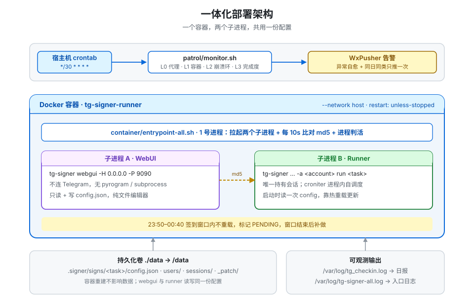
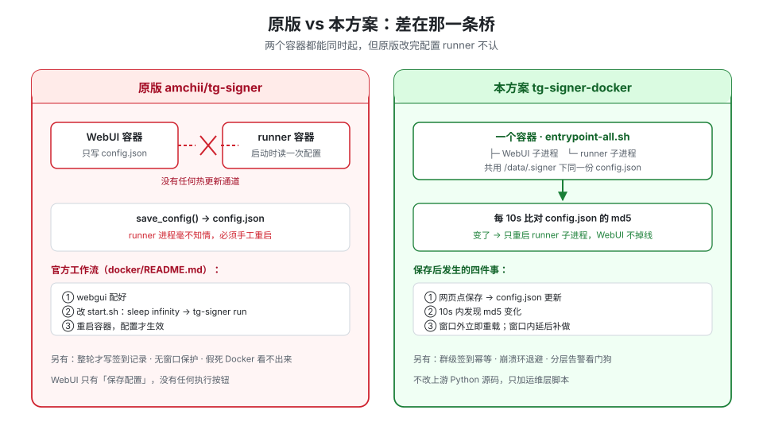
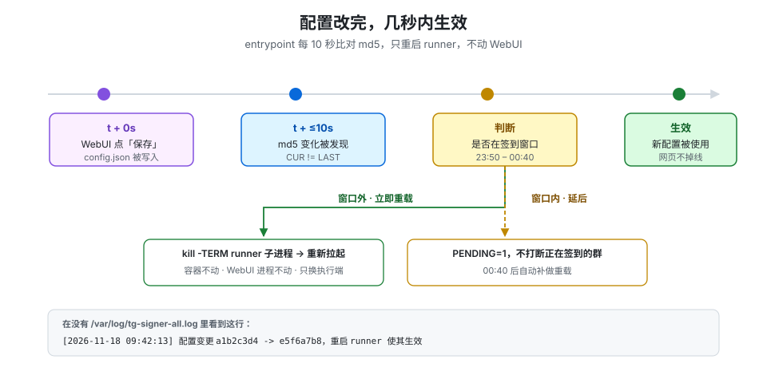
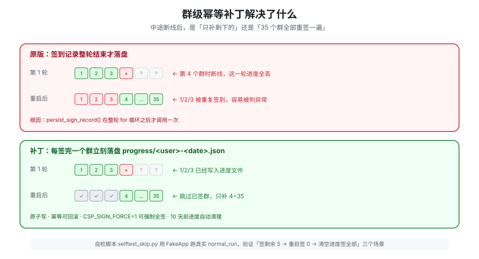
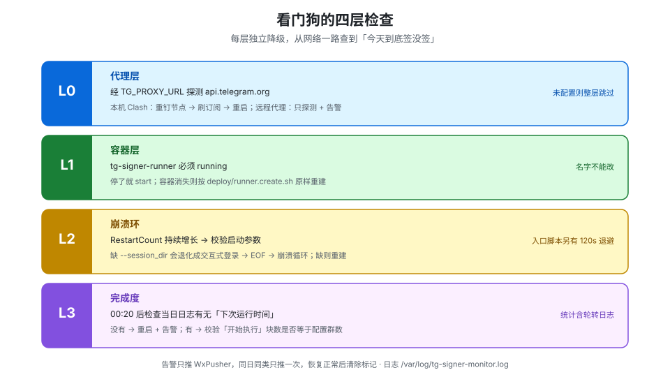

# tg-signer-docker

把 **tg-signer 的 WebUI 和签到 runner 装进同一个容器**，并补上上游缺失的「配置改完自动生效」和「签到中断不重复签」两块能力。

这不是 tg-signer 的 fork。上游代码一行没改，本仓库只放运维层脚本和文档。



**快速跳转**：[关于](#关于) · [和原版的区别](#和原版的区别) · [架构](#架构) · [部署](#部署) · [使用](#使用) · [升级](#升级) · [目录结构](#目录结构) · [安全](#安全) · [许可与归属](#许可与归属)

## 关于

[amchii/tg-signer](https://github.com/amchii/tg-signer) 是一个 Telegram 自动签到 / 消息监控工具，WebUI 用 NiceGUI 写成，负责**编辑配置**；真正执行签到的是另一个进程 `tg-signer run <任务名>`，它自带基于 croniter 的进程内调度器。

原版这两个部分之间只有一条通道：`<workdir>/signs/<task>/config.json`。runner 在启动时读一次配置就再也不看了。所以你只能：

1. 用 WebUI 配好；
2. 停掉容器；
3. 改 `start.sh`，把 `sleep infinity` 换成 `tg-signer run mytasks`；
4. 重启容器，配置才生效。

官方 `docker/README.md` 里那段 `start.sh` 的注释切换，就是这个问题被绕开的样子。

本仓库做的事，是把这四步压缩成「在网页上点保存，几秒后自动生效」，同时不破坏上游、不自己维护一份源码分支。

### 一个具体例子

假设你建了个任务叫 `my_sign`，WebUI 里加了一个群、签到词是「签到」。配置文件长这样：

```json
{
  "chats": [
    {
      "chat_id": "-1001234567890",
      "name": "每日签到群",
      "actions": [{ "action": 1, "text": "签到" }],
      "action_interval": 1,
      "delete_after": null
    }
  ],
  "sign_at": "0 6 * * *",
  "random_seconds": 300,
  "sign_interval": 3
}
```

`sign_at` 是 croniter 表达式：每天 06:00 执行，`random_seconds=300` 表示实际时间在 ±5 分钟内抖动。`sign_interval=3` 是每个群之间的间隔秒数——35 个群大约要跑两分钟，这也是为什么中途断线会是个真问题。

### 适合 / 不适合

| 适合 | 不适合 |
|---|---|
| 已经用 tg-signer，想长期稳定挂机签到 | 想改 tg-signer 的业务逻辑（那应该去 fork 上游） |
| 需要经常在 WebUI 调整群列表 / 签到词 | 只想跑一次签到，直接用上游 CLI 更轻 |
| 希望配置变更自动生效、漏签能收到告警 | 不熟悉 Docker 和 Linux 命令行 |
| 有 Telegram 代理环境（本机 Clash 或旁路由） | 没有可用的 Telegram 网络出口 |

## 和原版的区别

| 维度 | 原版 amchii/tg-signer | 本方案 |
|---|---|---|
| 容器形态 | CLI 镜像和 `-webui` 镜像是两个 tag、两个独立容器 | 一个容器两个子进程：WebUI + runner |
| WebUI 职责 | 只读写 `config.json`，**没有任何执行按钮** | 不变，仍是纯编辑器；不连 Telegram |
| 配置生效 | 必须重启 `run` 进程 | 入口脚本每 10s 比对 md5，变了只重启 runner 子进程，WebUI 不中断 |
| 签到窗口 | 无保护，重启可能打断正在跑的签到 | 23:50–00:40 内延后重载，窗口结束补做 |
| 断线重签 | 整轮群签完才写记录，中途断开会从头重签 | 群级进度落盘，重启只补签剩余群 |
| 进程自愈 | 靠 Docker restart；进程假死时 Docker 看不出来 | 容器内分别探活，5 分钟内重启 6 次则退避 120s |
| 外部看门狗 | 无 | L0 代理 / L1 容器 / L2 崩溃环 / L3 完成度，WxPusher 告警 |
| 上游代码 | — | **不改**:不重新分发 `tg_signer/*.py` |



逐条展开见 [docs/DIFFERENCES.md](docs/DIFFERENCES.md)。

## 架构

```
宿主机
├── crontab  */30 * * * *  patrol/monitor.sh  ── 分层自检 + WxPusher 告警
│
└── 容器 tg-signer-runner（--network host，单一容器）
    └── /entrypoint-all.sh（bash 监管进程）
        ├── WebUI 子进程   tg-signer webgui -H 0.0.0.0 -P 9090
        │      └── 只读写 /data/.signer/signs/<task>/config.json
        └── runner 子进程  tg-signer ... run <task>
               ├── 自带 croniter 调度
               └── 唯一持有 <account> 的 Telegram 会话

持久化：./data -> /data（.signer 配置、sessions、logs、_patch）
        /var/log -> /var/log（tg_checkin.log、tg-signer-all.log、monitor.log）
```

共存能成立的原因：`tg_signer/webui/*.py` 里没有 `pyrogram.Client`，也没有 `subprocess`，WebUI 根本不连 Telegram。所谓「WebUI 和 runner 抢会话会互踢」是不成立的，早期那个崩溃循环是 runner 自身的问题。

配置改完会发生什么：



群级幂等补丁解决的问题：



分层看门狗：



## 部署

需要一台 Linux 机器、Docker、以及可用的 Telegram 网络出口。全程约 5 分钟。

### 1. 准备目录

```bash
sudo mkdir -p /opt/tg-signer
cd /opt/tg-signer
git clone https://github.com/z563855878/tg-signer-docker.git .
cp .env.example .env
chmod 600 .env
```

### 2. 编辑 `.env`

必填只有 WebUI 授权码；其余按需改：

```bash
TG_SIGNER_GUI_AUTHCODE=$(openssl rand -hex 16)
TG_SIGNER_TASK=my_sign
TG_ACCOUNT=my_account
TG_PROXY=socks5://你的代理地址:1080
```

`TG_SIGNER_TASK` 要和你在 tg-signer 里建的任务目录名一致（即 `data/.signer/signs/<任务名>/config.json` 的那个 `<任务名>`）。

### 3. 首次登录并建任务

镜像里没有你的会话。先临时起一个交互式容器完成登录和任务配置：

```bash
source .env
docker run -it --rm --network host \
  -v "$TG_SIGNER_ROOT/data:/data" \
  -e TZ=Asia/Shanghai -e "TG_PROXY=$TG_PROXY" -e "TG_ACCOUNT=$TG_ACCOUNT" \
  "$TG_SIGNER_IMAGE" bash
```

容器里依次执行：

```bash
tg-signer login                 # 按提示输入手机号和验证码
tg-signer run <任务名>          # 按提示建立签到任务，建完 Ctrl+C 退出
exit
```

> 登录会写出 `data/.signer/users/<id>/latest_chats.json`。后面 WebUI 的「交互式配置」从这份缓存里挑群，所以缓存太旧时先跑一次 runner 刷新。

### 4. 起一体化容器

```bash
source .env
bash deploy/all-in-one.create.sh
bash deploy/webui.sh status
```

看到 `webgui started pid=...` 和 `runner started pid=...` 即成功。浏览器打开 `http://<机器IP>:9090`，输入授权码。

也可以用 compose，效果等价：

```bash
cp deploy/docker-compose.yml .
docker compose up -d
```

### 5.（可选）启用看门狗和报表推送

```bash
cp monitor.env.example monitor.env
# 填入 WXPUSHER_TOKEN / WXPUSHER_UID，不需要就留空
chmod 600 monitor.env

(crontab -l 2>/dev/null; echo '*/30 * * * * /opt/tg-signer/patrol/monitor.sh') | crontab -
```

看门狗的 L0 代理探测默认关闭。要启用就设 `TG_PROXY_URL`（例如 `socks5h://代理主机:1080`）；本机 Clash 自愈模式再设 `PROXY_LOCAL=1` 和 `PROXY_UNIT`。

完整的分步说明、参数表、systemd/cron 配置见 [docs/DEPLOY.md](docs/DEPLOY.md)。

## 使用

| 我想做的事 | 命令 / 位置 |
|---|---|
| 看整体状态（容器、进程、端口、配置、下次签到） | `bash deploy/webui.sh status` |
| 改群列表 / 签到词 | 打开 WebUI → 配置管理 → Signer → 保存；10 秒内自动生效 |
| 不想等，立刻重载 | `bash deploy/webui.sh apply`（只重启 runner，WebUI 不中断） |
| 命令行批量改群 | `tools/chats.py list/add/rm/text/find/tasks` |
| 从配置里移除某个群（自动备份） | `tools/edit_chats.py <群名> [--contains] [--dry]` |
| 看今天签到了哪些群 | WebUI → 签到记录，或 `tools/parse_checkin.py` |
| 手动补签一次 | `docker exec tg-signer-runner tg-signer run-once <任务名>` |
| 重建容器 | `bash deploy/webui.sh rebuild` |
| 回滚到原版双容器形态 | `bash deploy/webui.sh rollback` |

详细用法和故障排查见 [docs/USAGE.md](docs/USAGE.md) 和 [docs/RUNBOOK.md](docs/RUNBOOK.md)。

## 升级

**本方案钉死镜像版本，不用 `latest-webui`。** 上游发新版后按下面流程走：

```bash
# 1. 从新镜像抽出 core.py，离线演练群级幂等补丁
docker run --rm --entrypoint cat ghcr.io/amchii/tg-signer:<新版本>-webui \
  /usr/local/lib/python3.12/site-packages/tg_signer/core.py > /tmp/core_new.py
python3 patch/patch_tg_signer.py --file /tmp/core_new.py   # exit 2 = 锚点变了，先别升

# 2. 改 .env 里的 TG_SIGNER_IMAGE，重建
bash deploy/all-in-one.create.sh

# 3. 容器内跑回归自检（不联网、不发消息）
docker exec tg-signer-runner python3 /data/_patch/selftest_skip.py
```

补丁打不上时入口脚本只写 WARN 并继续运行（退化为上游原生的整轮重签），不会让签到挂掉。所以升级后务必确认 `/var/log/tg-signer-all.log` 里有 `csp-patch: OK`，或跑一遍自检。详见 [docs/UPGRADE.md](docs/UPGRADE.md)。

## 目录结构

```
.
├── README.md
├── LICENSE                 本仓库脚本的 MIT 许可
├── LICENSE.upstream        上游 BSD-3-Clause 全文
├── NOTICE.md               归属与交叉许可说明
├── .env.example            部署参数模板
├── monitor.env.example     告警凭据模板
├── container/
│   └── entrypoint-all.sh   一体化入口：拉起两个子进程 + md5 热重载 + 窗口保护
├── deploy/
│   ├── all-in-one.create.sh   推荐形态的重建脚本
│   ├── runner.create.sh       看门狗调用入口（委托给 all-in-one）
│   ├── runner.only.create.sh  回滚到纯 runner
│   ├── webui.create.sh        回滚形态的独立 WebUI 容器
│   ├── webui.sh               日常管理：status / apply / rebuild / rollback
│   └── docker-compose.yml     compose 等价写法
├── patch/
│   ├── patch_tg_signer.py    群级签到幂等补丁（幂等、可回滚）
│   └── selftest_skip.py      补丁回归自检（不联网）
├── patrol/monitor.sh         分层看门狗
├── tools/                    报表解析与群管理脚本
├── assets/                   架构与流程示意图（SVG）
└── docs/                     差异、部署、使用、升级、运维手册
```

## 安全

- **必设授权码**。WebUI 监听 `0.0.0.0`，`TG_SIGNER_GUI_AUTHCODE` 不能为空也不能用弱口令。上游的授权校验是明文比较且无限流（源码里自己留了 TODO），所以**不要把 9090 端口暴露到公网**；需要外网访问请用 SSH 隧道或反代加一层认证。
- **不要提交真实数据**。`data/`、`.env`、`monitor.env`、`*.session` 已在 `.gitignore` 中排除。你的配置、会话、签到记录和 WxPusher 凭据都不要进 git。
- **补丁会改容器内的 site-packages**。这是运行时注入，容器重建后会重新打；它按源码文本锚点匹配，上游改结构会失败。失败时退化为原版行为，不会崩，但会失去群级幂等保护。
- **非官方项目**，与 Telegram 及上游作者无关联。用非公开接口、有账号风险，签到结果不构成任何承诺。

## 许可与归属

- 本仓库自有脚本与文档：[MIT](LICENSE)，`Copyright (c) 2026 z563855878`。
- 上游项目：[amchii/tg-signer](https://github.com/amchii/tg-signer)，[BSD-3-Clause](LICENSE.upstream)，`Copyright (c) 2023, Amchii`。完整的归属与交叉许可说明见 [NOTICE.md](NOTICE.md)。
- `patch/patch_tg_signer.py` 含从上游 `core.py` 逐字复制的锚点字符串，该部分适用上游许可证。
- 上游作者不背书、不赞助、不参与本仓库；这里说的「原版」和「改进」都只是功能描述，不代表优劣评价。

## 免责声明

本项目按「现状」提供，不保证长期可用。Telegram 的接口和风控策略、上游 tg-signer 的实现、你所在网络的代理状况，任何一项变化都可能导致签到失败。使用 Telegram 客户端可能产生账号限制，风险自负。请勿用于任何违反所在地区法律或平台条款的用途。
