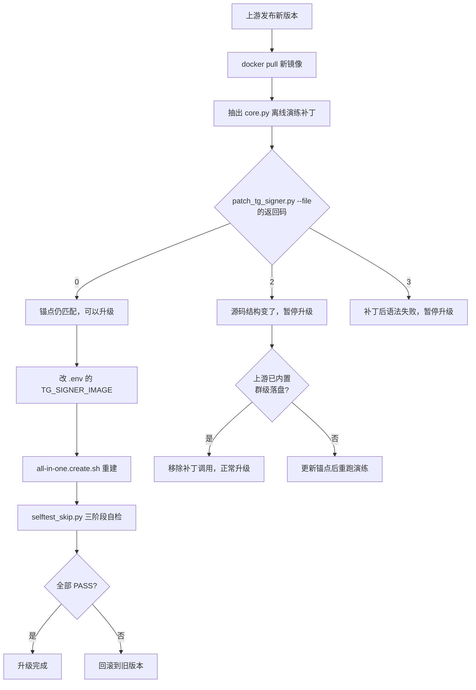

# 跟随上游升级

本方案钉死镜像版本（默认 `0.9.2-webui`），因为群级幂等补丁按源码文本锚点匹配。上游一旦改了那几行，补丁会静默失效。所以升级必须走门禁，不能直接把 `TG_SIGNER_IMAGE` 改成 `latest`。

升级决策流程：



## 为什么不能直接换 latest

`patch/patch_tg_signer.py` 依赖两个逐字锚点：

```python
OLD_LOOP = """        async def sign_once():
            for chat in config.chats:
                route_key = None
                try:
"""
OLD_MARK = """                if route_key is not None:
                    self.context.chat_messages[route_key].clear()
                await asyncio.sleep(config.sign_interval)
"""
```

它要求每个锚点在文件里**正好出现 1 次**，否则 return 2 不修改。入口脚本收到非 0 只写一行 WARN 然后照常启动 runner——签到不会挂，但退化成上游原生的「整轮重签」行为。

## 升级步骤

### 1. 查上游改了什么

```bash
git ls-remote --tags https://github.com/amchii/tg-signer.git | tail -20
```

读一下目标版本的 CHANGELOG，重点看 `core.py` 的 `normal_run` / `sign_once` / `sign_a_chat` 有没有动。

### 2. 离线演练补丁（关键）

从候选镜像里抽出 `core.py`，用补丁脚本的 `--file` 模式演练，**不碰线上容器**：

```bash
NEW=0.9.3-webui

docker pull ghcr.io/amchii/tg-signer:$NEW
docker run --rm --entrypoint cat ghcr.io/amchii/tg-signer:$NEW \
  /usr/local/lib/python3.12/site-packages/tg_signer/core.py > /tmp/core_new.py

python3 patch/patch_tg_signer.py --file /tmp/core_new.py
echo "rc=$?"
```

| 返回码 | 含义 | 处理 |
|---|---|---|
| `0` | 补丁可打（或已打过） | 可以继续 |
| `2` | 锚点匹配数不为 1，源码结构变了 | **不要升级**，先看第 4 节 |
| `3` | 补丁后语法校验失败 | 不要升级，报告问题 |
| `1` | 找不到文件 | 检查容器里 core.py 路径 |

顺便确认 CLI 契约没变：

```bash
docker run --rm --entrypoint tg-signer ghcr.io/amchii/tg-signer:$NEW --help
```

需要的 flag：`--session_dir`、`-a/--account`、`-w/--workdir`、`--log-dir`、`--log-file`，子命令 `run`、`run-once`、`webgui`（`-H/-P/-S`）。

### 3. 切版本并回归

```bash
# 改 .env
sed -i "s|^TG_SIGNER_IMAGE=.*|TG_SIGNER_IMAGE=ghcr.io/amchii/tg-signer:$NEW|" /opt/tg-signer/.env
source /opt/tg-signer/.env
bash deploy/all-in-one.create.sh
```

然后确认补丁打上、自检通过：

```bash
grep 'csp-patch' /var/log/tg-signer-all.log | tail -3
docker exec tg-signer-runner python3 /data/_patch/selftest_skip.py
```

自检三个 stage 都要 PASS：

- 预置 30/35 已签 → 只签剩余 5
- 模拟重启 → 签 0 个
- 清空进度 → 签全部

自检用 FakeApp 替换 pyrogram，不发任何 Telegram 消息，也不写线上进度文件。

### 4. 锚点变了怎么办

按优先级：

1. **先看上游是否已经修了这个问题**。搜 `core.py` 里 `sign_once` 有没有变成群级落盘。如果已经修了，直接从补丁注入的 helper 里退出，删掉 `patch_tg_signer.py` 的调用即可（改入口脚本 `ensure_patch()` 里加一句跳过）。
2. **更新锚点**。按新源码修改 `OLD_LOOP` / `OLD_MARK` / `NEW_LOOP` / `NEW_MARK` 四段，然后跑 `--file` 演练 + 自检。改完记得更新 `MARK` 版本号，避免旧容器上重复注入。
3. **提 PR 给上游**。这是群级幂等的通用 bug，任何人中途断线都会遇到。合并后本仓库就能删掉整个 `patch/` 目录。

不要做的：直接把 `latest-webui` 写进 `.env`，或者跳过 `--file` 演练直接切镜像。

## 5. 回滚

```bash
# 改回旧版本
sed -i "s|^TG_SIGNER_IMAGE=.*|TG_SIGNER_IMAGE=ghcr.io/amchii/tg-signer:0.9.2-webui|" /opt/tg-signer/.env
source /opt/tg-signer/.env
bash deploy/all-in-one.create.sh
```

数据全在 `./data` 卷里，镜像切换不影响配置、会话和签到记录。旧容器被删除前如需保留日志，先 `cp /var/log/tg_checkin.log <备份路径>`。

## 6. 长期建议

把「补丁静默失效」变成硬告警：在 `patrol/monitor.sh` 里加一条检查——最近一次 `runner started` 之前有没有 `csp-patch: OK`，没有就调 `alert`。默认是软降级（保证签到能跑），但你需要知道它什么时候退化成了原版行为。
