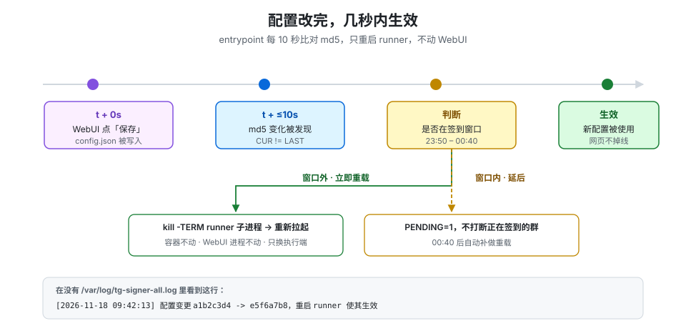

# 使用指南

前置条件：已按 [DEPLOY.md](DEPLOY.md) 部署，且执行过 `source /opt/tg-signer/.env`（或每次手工带上环境变量）。

## 1. 日常检查

```bash
cd /opt/tg-signer
bash deploy/webui.sh status
```

输出分段含义：

| 段 | 正常表现 |
|---|---|
| 容器 | `tg-signer-runner   Up ...`，且只应有一个 tg-signer 容器 |
| 容器内进程 | 两个 pid（webgui 与 runner）；如果只有一个，看 `/var/log/tg-signer-all.log` |
| 端口 | `0.0.0.0:<GUI_PORT>` 在监听 |
| WebUI 工作目录 | `workdir = /data/.signer`，任务列表里有你的任务名 |
| 配置 | 群数与 `config.json` 一致，md5 稳定 |
| 健康 | `TimeoutError` 不持续增长；runner 子进程启动次数不会异常飙升 |
| 下次签到 | 有「下次运行时间: ...」这行 |

## 2. 改配置

### 网页操作

WebUI → 配置管理 → Signer → 选择任务 → 编辑 JSON 或用「交互式配置」向导 → 保存。

保存后发生的事：

1. `save_config()` 写 `<workdir>/signs/<task>/config.json`
2. 入口脚本 10 秒内发现 md5 变化
3. 若在 23:50–00:40 窗口外：kill runner 子进程并重拉，WebUI 不受影响
4. 若在窗口内：记 `PENDING`，窗口结束后补做

日志证据在 `/var/log/tg-signer-all.log`：

```text
[2026-11-18 09:42:13] 配置变更 a1b2c3d4 -> e5f6a7b8，重启 runner 使其生效
[2026-11-18 09:42:13] runner started pid=147
```



一个完整的操作例子：给 `my_sign` 加一个新群。

```bash
# 1. 先在网页上加好群并保存，或者用命令行（不占 Telegram 会话）
python3 tools/chats.py add -1001234567890 --name "新签到群" --text 签到

# 2. 看重载有没有发生
tail -5 /var/log/tg-signer-all.log
# 期望看到：配置变更 xxxx -> yyyy，重启 runner 使其生效

# 3. 确认新群已被加载，下次签到会覆盖它
bash deploy/webui.sh status | grep -A2 '配置'
# 35 个群  ->  36 个群

# 4. 不想等那 10 秒就手工触发
bash deploy/webui.sh apply
```

### 立即生效

不想等 10 秒：

```bash
bash deploy/webui.sh apply
```

它找到 `run <任务名>` 那个子进程，发 TERM，等 15 秒，然后打印下次签到时间和当前配置 md5。容器和 WebUI 都不动。

## 3. 命令行管理群列表

`tools/chats.py` 直接改文件，不连 Telegram、不占会话。

```bash
python3 tools/chats.py list                        # 列出所有群
python3 tools/chats.py list --kw 关键词            # 过滤
python3 tools/chats.py tasks                       # 列出所有任务目录
python3 tools/chats.py find 关键字                 # 从 latest_chats.json 缓存反查 chat_id

python3 tools/chats.py add -1001234567890 \
  --name "示例群" --text 签到                      # 新增文本签到
python3 tools/chats.py add @channel --name 频道 --click 签到按钮
python3 tools/chats.py add -1001234567890 --dice '🎲'
python3 tools/chats.py add -1001234567890 --image --calc
python3 tools/chats.py add -1001234567890 --thread 1   # 论坛话题

python3 tools/chats.py rm 3                        # 按序号删
python3 tools/chats.py text 3 "打卡"               # 改签到词

python3 tools/chats.py add -1001234567890 --name 测试 --apply   # 改完立即重载
```

`--apply` 在推荐形态下调用 `deploy/webui.sh apply`，只重启 runner 子进程。回滚到双容器形态时会退回 `docker restart`。

按群名移除（自动备份配置文件）：

```bash
python3 tools/edit_chats.py "群名" --dry         # 先看会删什么
python3 tools/edit_chats.py "群名"               # 真删，备份写在 config.json.bak.<时间戳>
python3 tools/edit_chats.py "关键词" --contains  # 名称包含即匹配
```

## 4. 看签到结果

网页：WebUI → 签到记录 / 日志。

命令行日报：

```bash
python3 tools/parse_checkin.py
python3 tools/parse_checkin.py /var/log/tg_checkin.log my_sign --json
```

解析器做三件事：用「下次运行时间」定位最近一轮、用「开始执行」块切分群、用 tg-signer 自己的「忽略意料之外的聊天」WARNING 判定消息归属。因此 bot 的异步回复不会串群，日志轮转也不会漏计。

## 5. 手动补签

```bash
docker exec tg-signer-runner \
  tg-signer --session_dir /data/sessions -a my_account -w /data/.signer \
  run-once my_sign
```

`run-once` 会忽略「今天已签过」的判定，适合漏签后补做。注意群级进度文件里的已签群仍会被跳过；要强制全签加环境变量 `CSP_SIGN_FORCE=1`（会在微信里重复发签到，慎用）。

## 6. 重建与回滚

```bash
bash deploy/webui.sh rebuild      # 用当前 .env 重建一体化容器
bash deploy/webui.sh rollback     # 回滚到「纯 runner + 独立 WebUI」双容器
```

`rollback` 会执行 `runner.only.create.sh` 和 `webui.create.sh start`。这是**上游形态**：没有配置热重载、没有群级幂等补丁、WebUI 要另起容器。适合排查问题时临时用。

回到推荐形态：

```bash
source .env && bash deploy/all-in-one.create.sh
```

注意容器名始终是 `tg-signer-runner`，看门狗按这个名字找容器，改名会误判成容器丢失。

## 7. 看门狗演练

```bash
# 只推一条测试消息，不改任何状态
MONITOR_TEST_ALERT=1 /opt/tg-signer/patrol/monitor.sh

# 全流程演练：所有动作只打印不执行
MONITOR_DRYRUN=1 /opt/tg-signer/patrol/monitor.sh

# 模拟「今天的签到没跑」（需与 MONITOR_NOW 配合绕过时间短路）
MONITOR_TODAY=2026-01-01 MONITOR_NOW=0100 MONITOR_DRYRUN=1 \
  /opt/tg-signer/patrol/monitor.sh
```

看门狗日志在 `/var/log/tg-signer-monitor.log`。

## 8. 常见现象

| 现象 | 原因 / 处理 |
|---|---|
| WebUI 里没有任务 | `TG_SIGNER_WORKDIR` 没设，相对路径 `.signer` 被拼成 `/data/.signer/.signer`。重建容器 |
| 群列表为空 | `latest_chats.json` 缓存太旧，跑一次 runner 或 `tg-signer login` 刷新 |
| `CHANNEL_INVALID [400]` | 群 ID 失效或机器人不在群里，删掉该群 |
| `CHAT_WRITE_FORBIDDEN [403]` | 账号没发消息权限，检查账号状态 |
| 容器 Up 但没签到 | 典型假死：事件循环卡住，Docker 看不出来。看门狗 L3 会重启；手工可 `webui.sh apply` |
| 日志出现 `csp-patch WARN` | 上游源码结构变了，补丁没打上。签到仍能跑，但失去群级幂等。见 [UPGRADE.md](UPGRADE.md) |
